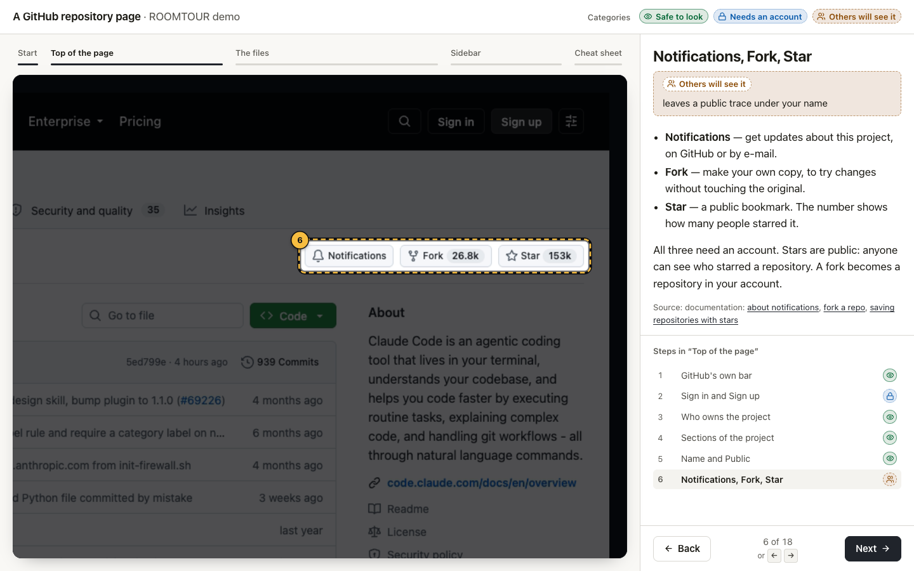
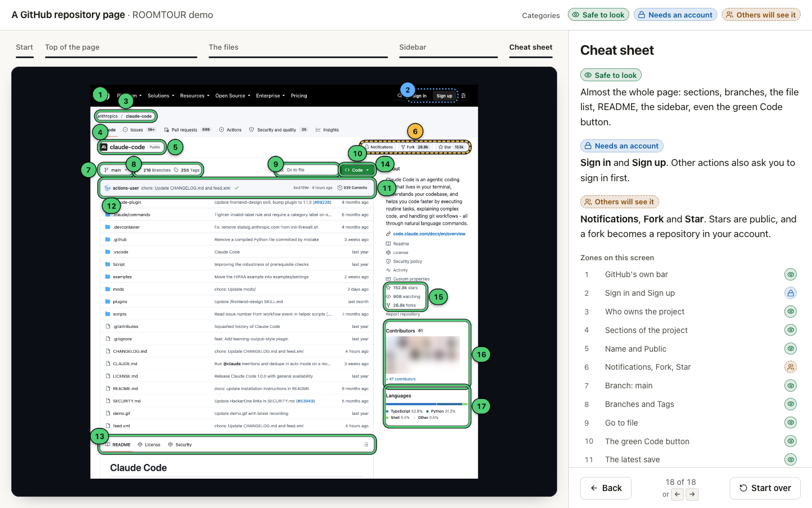

# ROOMTOUR

**Step-by-step guided tours over real screenshots of any interface.** Tell Claude what to explain: GitHub, your mail, or your own app running on your computer. You get a local page. A camera moves to one zone at a time and dims the rest. A panel explains each zone in plain words. Each zone carries a category you choose, so you know what a click does before you make it.

[Українською → README.uk.md](README.uk.md)

## Quick start

You need Claude Code and [Node.js 18+](https://nodejs.org). In a terminal (Mac or Windows), once:

```bash
claude plugin marketplace add alex-Drop2201/roomtour
claude plugin install roomtour@roomtour
```

Restart Claude Code. A plugin installed from the terminal also appears in the desktop app's Code tab: the **+** button next to the prompt → **Add plugins** lists it.

Type `/roomtour` with a link, or write "make a tour of …". Claude opens the site first. If it needs a sign-in, you sign in in the browser Claude shows you. Then one round of up to four questions: language (first time only), which part, how to explain, and the categories. Then Claude works on its own and opens the tour.

Tour a link, a local address such as `http://localhost:3000`, screenshots you send, or your product with its code folder. Your language, explanation level and tours folder are saved after the first round. To change them, say "roomtour settings".





## What you get

- **A real screen, one zone at a time.** No diagrams: the actual interface, zoomed to each zone, with the rest dimmed.
- **Plain words at your level.** As to a child, as to a newcomer, or as to a colleague. You choose at the start of every tour.
- **Your own categories.** For GitHub they may be "safe to look / others will see it / ask first". For mail: "reading / organising / sends or deletes". Claude proposes, you decide. Each category has its own icon, outline and colour, so it reads without colour too.
- **Checked, or marked as a guess.** Every claim comes from the screen, the product's docs or its code, or says "probably". Give Claude your code folder, and it checks what each button does.
- **Private by default.** Screenshots stay on your computer. Personal data can be blurred. Claude never clicks anything that changes data.
- **English, Ukrainian and Russian** out of the box, on Mac and Windows.

## Open a tour again

Each tour sits in its own folder inside your tours folder (`~/Documents/roomtour` by default). Ask Claude "open the tour <name>", or start the server yourself:

```bash
node "<tours folder>/_roomtour/serve.mjs" "<tours folder>"
```

Then open the address it prints. Chrome and Edge can also open a tour's `index.html` directly.

## Try the demo first

The demo is a tour of a public GitHub repository page, in English and Ukrainian. Clone this repository and serve it:

```bash
git clone https://github.com/alex-Drop2201/roomtour.git
cd roomtour
node plugins/roomtour/skills/roomtour/scripts/serve.mjs .
```

Open the address it prints (usually `http://127.0.0.1:8770/`) and add `examples/github-repo/` for English or `examples/github-repo/index.uk.html` for Ukrainian. Chrome and Edge can also open `examples/github-repo/index.html` directly.

## Requirements

- **Claude Code** — the Code tab of the Claude desktop app, or `claude` in a terminal.
- **Node.js 18 or newer** — for the scripts that create, check and show tours. Download the LTS version from nodejs.org.
- **Sites behind a sign-in** use the desktop app's built-in browser or your Chrome. You sign in yourself. The built-in browser is sharp up to about 800 px wide.
- **Optional: Playwright, for sharp public pages and local apps at any width.** Once, in a terminal:

  ```bash
  claude mcp add --scope user playwright -- npx @playwright/mcp@latest
  ```

- **Optional:** the [Impeccable](https://github.com/pbakaus/impeccable) skill for a design review of tours you share, and ffmpeg for stitching and blurring images. ROOMTOUR works without both.

## Privacy

- Claude only looks. It never clicks anything that saves, sends, deletes, approves or changes a setting on the site you tour.
- Screenshots of private or signed-in screens stay on your computer. Each tour's `shots/` folder is kept out of git.
- Names, e-mails, faces and other personal data can be blurred on the page. The PNG files keep the original, unless Claude blurs them too for a tour you share.
- Claude uploads or publishes nothing unless you ask for that exact tour.

## Update and remove

```bash
claude plugin marketplace update roomtour
claude plugin update roomtour@roomtour
```

Restart Claude Code to apply an update. Your settings and tours stay. To remove: `claude plugin uninstall roomtour@roomtour`.

## Troubleshooting

- **A blank page, or "The screenshots did not load"** — the page was opened as a file in a browser that blocks neighbouring files. Claude's built-in browser does that. Open the tour through the serve script, or in Chrome or Edge.
- **Claude asks you to sign in, but you see no window** — Playwright usually runs without one. Ask Claude to use the built-in browser pane instead.
- **Blurry screenshots** — the built-in browser was wider than about 800 px. Ask Claude to capture at 800 px, or install Playwright for public pages.
- **`node` is not found** — install Node.js LTS and reopen Claude Code.

## What is inside

```
.claude-plugin/marketplace.json          this repository as a plugin marketplace
PRODUCT.md, DESIGN.md                    what ROOMTOUR is for, and the engine's design system
plugins/roomtour/
  .claude-plugin/plugin.json             the plugin
  skills/roomtour/SKILL.md               how Claude makes a tour, stage by stage
  skills/roomtour/references/            onboarding, intake, capture, writing, data format, quality
  skills/roomtour/assets/engine/         the tour engine (roomtour.css, roomtour.js)
  skills/roomtour/assets/template/       the page shell for a new tour
  skills/roomtour/scripts/               new-tour.mjs, check.mjs, serve.mjs (Node, no dependencies)
examples/github-repo/                    the demo tour, English and Ukrainian
```

## Licence

MIT — see [LICENSE](LICENSE). Made by Alex Panin. Version 0.2.0.
